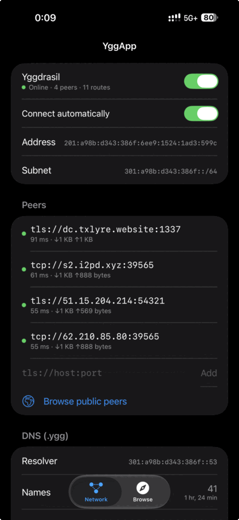
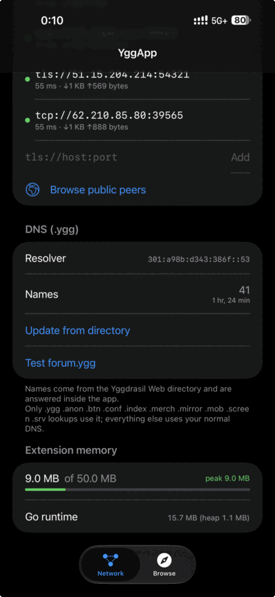
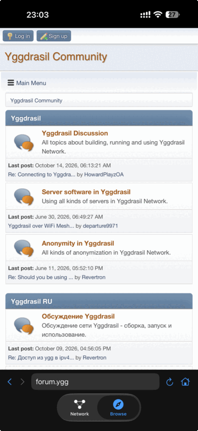
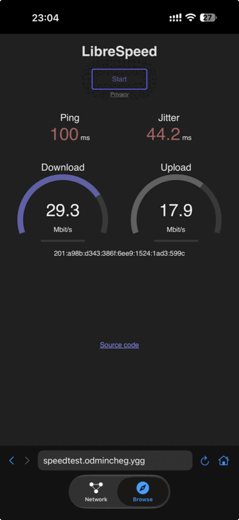

# YggApp

A native iOS and macOS client for the [Yggdrasil Network](https://yggdrasil-network.github.io/): an end-to-end encrypted IPv6 overlay mesh. Your iPhone or Mac gets its own `200::/7` address and can reach any Yggdrasil node or service directly, alongside your normal internet.

> **Status: alpha.** Every feature below has been tested on a real iPhone and Mac. The macOS app can be downloaded below. The iOS app is not on the App Store or TestFlight yet, so on iPhone you need to build it yourself (see [Building](#building)).

## Download for macOS

**[Download the latest YggApp for macOS (.dmg)](https://github.com/prietus/yggapp/releases/latest)**: signed with Developer ID and notarized by Apple.

Or install it with [Homebrew](https://brew.sh):

```sh
brew install --cask prietus/tap/yggapp
```

Upgrade with `brew upgrade --cask yggapp`.

- **Requirements:** macOS 14 Sonoma or later, Apple silicon or Intel.
- **Install:** open the DMG and drag **YggApp** to **Applications**. It has to be in Applications for macOS to load its network extension.
- **First launch:** YggApp lives in the menu bar (the connected-nodes icon), not the Dock. macOS will ask you to allow its network extension in **System Settings → General → Login Items & Extensions**, and the first time you connect it asks to add a VPN configuration.
- **Peers:** open **Open YggApp… → Browse public peers** and use **Add fastest**. After that, Safari opens `.ygg` sites such as `http://forum.ygg/` directly.

The menu bar panel has the same switches as the iOS app: connect, connect automatically, your address and live peers. The full window has peers, the public peer picker and the `.ygg` name table.

<p align="center">
  
  
  
  
</p>

## Features

- **Packet tunnel**: Yggdrasil 0.5.x runs in a Network Extension. The Go core reads and writes the `utun` file descriptor directly, so packets never pass through Swift.
- **Public peer picker**: online peers from [publicpeers.neilalexander.dev](https://publicpeers.neilalexander.dev/), listed by country. Latency is measured from your device and peers are sorted by it. "Add fastest" adds the two fastest peers.
- **`.ygg` and other ALFIS names**: a resolver inside the tunnel answers names from the [Yggdrasil Web directory](http://[21e:a51c:885b:7db0:166e:927:98cd:d186]/) instantly (its ALFIS domain column, refreshed every 24 h) and forwards every other name, over Yggdrasil, to the [ALFIS resolvers run by Revertron](https://dns.r3v.dev). If one doesn't answer it tries the next, and it keeps using whichever answered last. If they are all down, directory names still work. Split DNS sends only ALFIS zones (`.ygg .anon .btn .conf .index .merch .mirror .mob .screen .srv`) there, so all other lookups use your normal DNS.
- **Built-in browser**: you can type `forum.ygg` or a bare IPv6 address without `http://`, and the address bar suggests names from the table as you type. The start page is the directory.
- **Auto-connect**: uses iOS On Demand rules, so the tunnel stays up across Wi-Fi and cellular. It redials peers right away when the network changes or the phone wakes. A manual disconnect stays off.
- **Control Center toggle** (iOS 18+): also works from the Lock Screen and the Action button.
- **Clear status**: shows "no peers", "connecting" or "online · N peers · M routes", plus live extension memory measured against the ~50 MB limit iOS enforces.

Measured on an iPhone over two public peers: about 29 Mbit/s down and 18 Mbit/s up through Yggdrasil, with a peak extension footprint of about 15 MB.

## How it works

```
┌────────────── App (SwiftUI) ──────────────┐      ┌──────── PacketTunnel extension ────────┐
│ Network tab · Browse tab (WKWebView)      │ IPC  │ NEPacketTunnelProvider                 │
│ Peer picker · directory sync              │◄────►│   └─ yggkit (Go, via gomobile)         │
└───────────────────────────────────────────┘      │        ├─ yggdrasil-go core            │
              ▲ App Group (peers, names)           │        ├─ utun fd  ⇄ Yggdrasil         │
              ▼                                    │        └─ DNS on <subnet>::53          │
┌─ YggWidgets (Control Center toggle) ──────┐      └────────────────────────────────────────┘
```

- `yggkit/`: a small gomobile wrapper around `yggdrasil-go`. It starts the node, attaches the utun descriptor, manages peers live, and includes a DNS interceptor that answers `<node subnet>::53` from an in-memory table.
- `PacketTunnel/`: the extension. It sets up routes for `200::/7`, split DNS and memory reporting. The node's private key is stored in the extension's Keychain.
- `App/`, `Shared/`, `Widgets/`: the UI, the shared state stored in the App Group, and the Control Center toggle.

## Building

Requirements: a Mac with Xcode (iOS 16+ SDK), Go, [XcodeGen](https://github.com/yonaskolb/XcodeGen), and an Apple Developer account. The free tier can't use Network Extensions.

```sh
go install golang.org/x/mobile/cmd/gomobile@latest golang.org/x/mobile/cmd/gobind@latest
gomobile init
./build-yggkit.sh        # builds Frameworks/Yggkit.xcframework
xcodegen generate        # creates YggApp.xcodeproj
open YggApp.xcodeproj
```

Before you run it on a device, replace my identifiers with your own:

- `project.yml`: `DEVELOPMENT_TEAM` and the `com.prietus.yggapp*` bundle IDs and App Group
- `Shared/Shared.swift`: `AppIDs` (the App Group and tunnel bundle ID)

With automatic signing, Xcode registers the App IDs with the Network Extension and App Group capabilities.

**macOS:** build the `YggAppMac` scheme. The tunnel is a system extension, so macOS only activates it when the app runs from `/Applications`: copy the built `YggApp.app` there before launching it. Release builds are made by `release/release-macos.sh` (Developer ID signing, notarization and DMG), which the [macOS release workflow](.github/workflows/release-macos.yml) runs on every `v*` tag.

## Testing

```sh
./test.sh
```

This runs the Go tests (with `-race`) and the Swift unit tests on a simulator: directory parsing, browser address handling, DNS wire format and the public peer list. The tunnel itself can only be tested on a real device.

## Privacy

- No analytics and no third-party SDKs.
- The app makes these network requests outside the tunnel: the public peer list from `publicpeers.neilalexander.dev`, plus TCP connects to candidate peers to measure latency.
- The Web directory is fetched over Yggdrasil. DNS for ALFIS zones never leaves the device.
- Your node keypair is generated on the device and stays in the Keychain. It is included in encrypted backups, so your address survives a restore.

## Known limitations

- **Names**: names outside the Web directory depend on Revertron's ALFIS resolvers being reachable. The older ones listed on the Yggdrasil services page were shut down in November 2024. Those resolvers also filter ads (AdGuard Home).
- **LAN discovery**: there is no multicast peer discovery, because it needs Apple's multicast entitlement.
- **Distribution**: Apple only allows VPN-type apps on the App Store from developers enrolled as organizations.

## Third-party software

The code in this repository is MIT-licensed (see [LICENSE](LICENSE)). The app statically links these libraries, which keep their own licenses:

| Library | License |
|---|---|
| [yggdrasil-go](https://github.com/yggdrasil-network/yggdrasil-go) | LGPLv3 with a static-linking exception |
| [ironwood](https://github.com/Arceliar/ironwood), [phony](https://github.com/Arceliar/phony) | MPL-2.0 |
| [wireguard-go](https://git.zx2c4.com/wireguard-go) (TUN), [quic-go](https://github.com/quic-go/quic-go), [hjson-go](https://github.com/hjson/hjson-go) | MIT |
| [coder/websocket](https://github.com/coder/websocket) | ISC |
| golang.org/x/{crypto,net,sys,text}, [edwards25519](https://filippo.io/edwards25519), [gologme/log](https://github.com/gologme/log), [bits-and-blooms](https://github.com/bits-and-blooms) | BSD |

## Acknowledgements

The Yggdrasil developers built the network and the core library. Neil Alexander's [yggdrasil-ios](https://github.com/yggdrasil-network/yggdrasil-ios) served as a reference for wiring gomobile into a packet tunnel. The [Yggdrasil Web directory](http://[21e:a51c:885b:7db0:166e:927:98cd:d186]/) and its maintainers make `.ygg` names usable without ALFIS resolvers.
